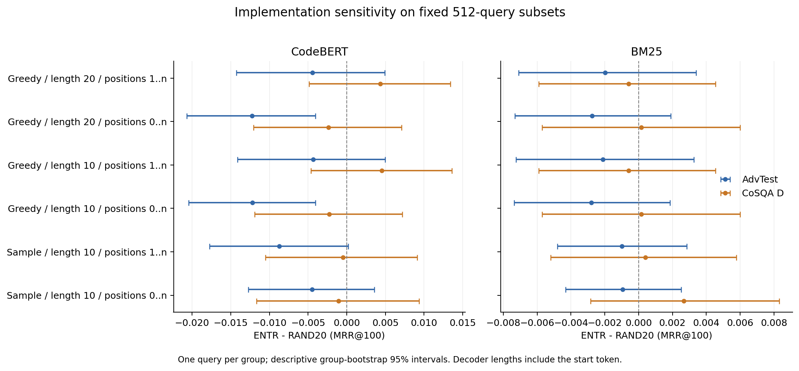

# SSQR复现公平性补强：原数据桥接与实现敏感性

状态：实际生成、双检索器排名、独立RR及真实T5检查完成。证据角色为确认后补充诊断；CoSQA只用开发D，不改已有H确认。

## 结果先看

源数据桥接也未形成可明确归于负熵位置选择的正向优势；不能把CoSQA确认结果归因于真实查询迁移。源侧差异与不可恢复的训练/权重因素仍须分开解释，本轮不把差异清单写成已经确定的失败原因。

主线继续是SSQR式候选收益的外部复现与自动采纳分析。本文可以报告经过核对的重建结果、有限实现敏感性和冻结阶段效用；不以补充诊断冒充新的独立确认，也不据此推广全部UQ有效或无效。

## 同一实现的源数据桥接

原AdvTest固定哈希抽2048条/594仓库，搜索作者split顺序的全部19210原测试函数。查询及代码逐URL对照作者输入一致。CoSQA复用D1490/512、6267函数。两边同T5、同CodeBERT、1…n位置、greedy/总decoder20、k=3和RAND20。

下表best3不包含NoRewrite；Δ是相对各自原查询，绝对MRR不跨数据直接比较。区间为10000次关联组bootstrap95%。
本表沿用已冻结的逐query最大RR定义。公开评估器的重复URL处理与另外两种聚合口径，另见`../rene_ssqr_aggregation_audit_20261019/READOUT.md`；没有声称原作者的生产聚合路径已恢复。

| 检索器 | 数据与查询数 | NoRewrite MRR | ENTR best3 ΔMRR | ENTR−RAND20 | 95%区间 |
|---|---|---:|---:|---:|---|
| CodeBERT | AdvTest 2048 | 0.30874417 | +0.02399075 | -0.00435302 | [-0.00822558, -0.00033732] |
| CodeBERT | CoSQA D1490 | 0.51890040 | +0.06037845 | +0.00236800 | [-0.00354366, +0.00796936] |
| BM25 | AdvTest 2048 | 0.21275343 | +0.00415845 | -0.00133742 | [-0.00331732, +0.00061543] |
| BM25 | CoSQA D1490 | 0.22412467 | +0.00977629 | -0.00194770 | [-0.00494417, +0.00106370] |

直接估计源−CoSQA的ENTR−RAND效应差，跨域共享仓库合成同一重采样组，保留协方差：

| 检索器 | 源−CoSQA效应差 | 组t95% | 组bootstrap95% | 共享组/联合组 |
|---|---:|---|---|---:|
| CodeBERT | -0.00672102 | [-0.01372981, +0.00028777] | [-0.01364477, +0.00045645] | 34/1072 |
| BM25 | +0.00061028 | [-0.00294121, +0.00416177] | [-0.00288441, +0.00418412] | 34/1072 |

原SSQR表4ENTR−RAND=.2221−.1886=+.0335；本地权重、训练细节及运行时不同，不能把原文数值当作本地对照臂。源数据桥接仍同时改变语料、查询长度、标签与难度，因此没有识别纯查询来源因果。

## 六种有限设置敏感性

以下两域均为事先固定每组一条的512查询子集，所有profile用完全相同的查询；与上表查询加权主桥接总体不同。total decoder长度包含start，10对应9个new tokens，是显式m10操作化而非声称恢复原历史计数。采样每位置1条、固定位置局部RNG，共同位置复用；不是多seed集成。以下均为full-label entropy下的ENTR−RAND20。

| 设置 | AdvTest CodeBERT | CoSQA CodeBERT | AdvTest BM25 | CoSQA BM25 |
|---|---:|---:|---:|---:|
| greedy20_source | -0.00442004 | +0.00434089 | -0.00198183 | -0.00059215 |
| greedy20_all | -0.01226867 | -0.00238535 | -0.00276119 | +0.00016080 |
| greedy10_source | -0.00434817 | +0.00452735 | -0.00211089 | -0.00059357 |
| greedy10_all | -0.01218871 | -0.00225219 | -0.00280263 | +0.00015811 |
| sample10_source | -0.00870789 | -0.00046114 | -0.00098711 | +0.00039942 |
| sample10_all | -0.00447282 | -0.00104229 | -0.00095484 | +0.00266645 |

有限配对改动的CodeBERT结果（同查询、同采样共同位置；Δ指ENTR−RAND效应的改变量）：

| 改动 | 数据 | 效应改变量 | 配对bootstrap95% |
|---|---|---:|---|
| position_greedy20 | source | -0.00784863 | [-0.01722201, +0.00102902] |
| length_source | source | +0.00007186 | [-0.00024619, +0.00042480] |
| sampling_source | source | -0.00435972 | [-0.01705003, +0.00878252] |
| sampling_all | source | +0.00771589 | [-0.00417838, +0.01957007] |
| paper_oriented_joint | source | -0.00005279 | [-0.01291643, +0.01292661] |
| position_greedy20 | cosqa | -0.00672623 | [-0.01451093, +0.00027443] |
| length_source | cosqa | +0.00018646 | [-0.00001035, +0.00047182] |
| sampling_source | cosqa | -0.00498849 | [-0.01730013, +0.00708399] |
| sampling_all | cosqa | +0.00120991 | [-0.01199839, +0.01438868] |
| paper_oriented_joint | cosqa | -0.00538317 | [-0.01859540, +0.00753700] |

完整PROB、lexical-only及各设置区间见`metrics/RESULTS.json`。所有profile均保留；没有根据这些点估计替换确认配置或升级正式模块。

## 三候选聚合本身改变估计对象

同一批候选和排名，先逐query取最好RR再平均，与先计算各选序的整体MRR再取最好，回答的是两个问题。后一指标也不等于不看标签即可部署的政策。公开reader末行行为作为第三口径单列。

| 数据/检索器 | 逐query best3 E−R | 三个rank-wise MRR取最好 E−R | 末行 E−R |
|---|---:|---:|---:|
| source/CodeBERT | -0.00435302 | +0.00156252 | +0.00172419 |
| source/BM25 | -0.00133742 | +0.00110986 | +0.00171944 |
| cosqa/CodeBERT | +0.00236800 | +0.02294983 | -0.00046317 |
| cosqa/BM25 | -0.00194770 | +0.00369643 | -0.00682315 |

CoSQA D/CodeBERT的rank-wise最好口径点估计为+0.02294983；预定66均值同时界传播后的保守95%区间为[-0.09028707, +0.13570056]。它不是已确认的优势，也不能被逐query best3的等效结论替代。完整三口径和区间见聚合补充报告。

直接执行作者公开evaluator的同URL三行合成例，末行结果为0，逐query best3为1；这确认了公开reader覆盖行为，没有恢复作者当年生产表格的聚合路径。论文将明确写成在预先定义的逐query机会指标下进行外部重建，不把原表4的全部口径视作已经精确恢复。

## 既有独立确认如何保留

CoSQA确认H已在21:37一次消费：7718/1963主比较ENTR−RAND=−.00083652，组t95%[−.00320993,+.00153688]、bootstrap95%[−.00325479,+.00154146]均在事前±.005内。源桥接/D敏感性没有改动该指定比较，也不能把别的profile套入该H区间。

±.005事前冻结；作为量级说明，它约为原表4负熵−随机差.0335的14.9%。.005 MRR亦相当于1%的查询从rank2升到rank1所带来的平均变化。这是可读的指标尺度说明，不是用户满意度研究或对所有应用的最小重要差异证明。

全H8530的三候选best3Δ为CodeBERT+.05655770、BM25+.01358236；这些候选级机会及收益→CE→风险的阶段结果支持原文档的研究主线，不能等同于一种新UQ算法已经稳定提高自动效用。

## 已补齐的复现依据与保留的差异

1. 原数据查询、完整搜索池、源行/URL与qrels身份核对；没有用4096池或45244辅助文件替代原论文搜索池。
2. 同权重双数据桥接、直接域间差、六profile及两种熵掩码；位置消融不改变共同候选或采样随机流。
3. 论文实现差异表及方法文本，区分已修正的query/熵/CodeBERT目标和仍不同的CQC训练；新增公开evaluator重复URL覆盖及三口径核对。
4. 独立RR、真实模型检查和可移植缓存重放；已有确认与五正式指针保持。

作者原权重不可提供、本地T5训练来源/遮盖/优化器/长度与公开trainer不同、PROB原实现未公开、历史m计数/生产tie/三候选生产聚合路径不能恢复。这些已写入Design及artifact；不得由数值审计通过推成与作者模型完全相同。

## 验收与交付

- 协议SHA256：`7d3d4c0728aa413a21dfc748d4a01dc4f29d5d59a0b4a44591eb48793dc3d95e`；13项契约测试通过。
- 独立Fraction RR核对：271096项，最大差2.22e-16。
- 真实T5采样与FP64熵：6候选，最大熵差6.13e-07；抽样生成token一致。
- 可移植artifact额外验收见`../rene_ssqr_bridge_release_20261019/RELEASE_ACCEPTANCE.json`；独立脚本不导入workspace，缓存重放不冒称完整重训。
- 代码：`experiments/rene_ssqr_bridge_20261019/`；报告和主数据：本目录；论文：`paper/rene2027/implementation_fidelity.md`与`replication_results.md`。
- 五正式指针、旧权重与确认结果保留，risk_certified=false、NoRewrite状态保持。
